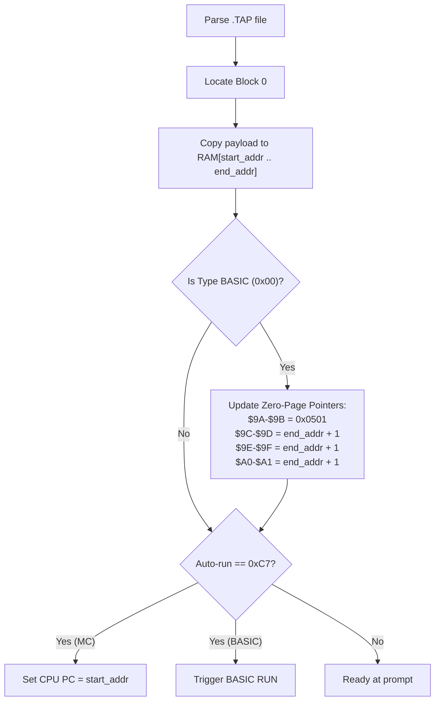

# Oric Tape Format (`.tap`) Specification & Architecture

This document provides a comprehensive technical reference for the **`.tap`** tape container format used by Tangerine / Oric computers (**Oric-1**, **Oric Atmos**, **Telestrat**, and **Pravetz 8D**). It describes the physical-to-logical relationship, block structures, header fields, ROM loader subroutines, multi-block streaming, and emulator implementation techniques.

---

## Table of Contents

1. [Overview](#1-overview)
2. [Physical Tape vs Logical `.tap` Format](#2-physical-tape-vs-logical-tap-format)
3. [Global TAP Container Layout](#3-global-tap-container-layout)
4. [Tape Block Anatomy](#4-tape-block-anatomy)
   - [4.1 Synchronization Sequence](#41-synchronization-sequence)
   - [4.2 9-Byte Header](#42-9-byte-header)
   - [4.3 Filename String](#43-filename-string)
   - [4.4 Payload Data](#44-payload-data)
5. [Oric ROM Tape Subroutines & Operation](#5-oric-rom-tape-subroutines--operation)
   - [5.1 Tape Entry Points & Vectors](#51-tape-entry-points--vectors)
   - [5.2 ROM Header Buffer & Memory Maps](#52-rom-header-buffer--memory-maps)
   - [5.3 BASIC Program Post-Loading Processing](#53-basic-program-post-loading-processing)
   - [5.4 Machine Code Execution Flow](#54-machine-code-execution-flow)
6. [Multi-Block Tapes](#6-multi-block-tapes)
7. [Real-World Annotated Hex Dumps](#7-real-world-annotated-hex-dumps)
8. [Emulator Implementation Guide](#8-emulator-implementation-guide)
   - [8.1 Instant RAM Injection](#81-instant-ram-injection)
   - [8.2 ROM Trap Emulation (Fast Load)](#82-rom-trap-emulation-fast-load)
9. [Reference Python Parser / Generator](#9-reference-python-parser--generator)

---

## 1. Overview

On real vintage hardware, software was stored and distributed on standard audio cassettes. Audio cassette reading is susceptible to tape stretch, head misalignment, and volume fluctuations.

The **`.tap`** file format is a digital container that discards the physical audio carrier waves (sine/square pulses, lead-in tones, and parity framing) to store only the **clean, decoded logical byte stream** exchanged between the Oric ROM tape firmware and the computer's 6502 CPU / 6522 VIA.

Key characteristics:
- **Compact size**: Exactly equals the sum of synchronisation markers, headers, filenames, and raw program payloads.
- **Cycle-free decoding**: Enables instantaneous RAM injection or fast ROM-level trapping without simulating millions of audio cycles.
- **Native ROM fidelity**: Follows the exact byte protocol expected by Oric BASIC `CLOAD` and `CSAVE` commands.

---

## 2. Physical Tape vs Logical `.tap` Format

### Physical Recording on Oric Hardware

The Oric hardware uses the 6522 VIA (Versatile Interface Adapter) and the AY-3-8912 PSG (Programmable Sound Generator) port to write and read cassette audio:
- **Speeds**:
  - **Fast (2400 bauds)**: Default speed for Oric-1 and Atmos. Employs differentiated frequency pulses (~0.416 ms per bit).
  - **Slow (300 bauds)**: Kansas City standard audio frequency shift keying (FSK) (1200 Hz / 2400 Hz), selected with `CSAVE "NAME",S`.
- **Bit Framing**: Each transmitted byte physically consists of:
  - 1 Start bit (`0`)
  - 8 Data bits (least significant bit first, **LSB first**)
  - 1 Parity bit (**Even parity**)
  - 1 or more Stop bits (`1`)

### Logical `.tap` Representation

A `.tap` file strips away the analog carrier waves, start bits, parity bits, and stop bits. Only the decoded 8-bit bytes are stored sequentially:

```
[Physical Tape] Audio leader tone -> Start bit -> 8 data bits -> Parity -> Stop bit(s) ...
                                       |
                              Demodulated by ROM / UART
                                       v
[Logical .tap]  0x16 0x16 0x16 0x24  [9-byte Header]  [Name\0]  [Payload Bytes...]
```

---

## 3. Global TAP Container Layout

A `.tap` file consists of one or more **Blocks** concatenated end-to-end:

```
+-------------------------------------------------------+
|                      .TAP File                        |
+-------------------------------------------------------+
|  Block 0 (e.g. BASIC Loader or Machine Code)          |
|    - Synchronization Sequence (0x16... 0x24)          |
|    - 9-byte Block Header                              |
|    - Null-terminated Filename String                  |
|    - Payload Data (End - Start + 1 bytes)             |
+-------------------------------------------------------+
|  Block 1 (Optional: e.g. Hi-Res Screen Image)         |
+-------------------------------------------------------+
|  Block N (Optional: Main Binary / Game Levels)        |
+-------------------------------------------------------+
```

---

## 4. Tape Block Anatomy

Every block in a `.tap` file follows a strict sequential structure:

```
+------------------+----------+---------------+-------------------+
|  Sync Sequence   |  Header  |   Filename    |   Payload Data    |
| (0x16... + 0x24) | (9 bytes)| (ASCII + 0x00)| (Variable length) |
+------------------+----------+---------------+-------------------+
```

### 4.1 Synchronization Sequence

Before the header, the Oric ROM expects a synchronization leader:
- **`0x16` (ASCII SYN)**: Repeated byte. On physical tapes, this leader lasts hundreds of bytes to allow the cassette AGC and phase lock to stabilize. In `.tap` files, emulators typically store between 1 and 4 repetitions of `0x16` (standard is `0x16 0x16 0x16`).
- **`0x24` (`$` character)**: Header synchronization mark. It immediately precedes the 9-byte header and indicates to the ROM that the subsequent byte is the start of the header.

> **Implementation Rule**: A parser searching for the next block should scan for `0x16` followed by `0x24`.

---

### 4.2 9-Byte Header

The header contains critical loading metadata.

| Offset | Field Name | Type | Description |
|:---:|:---|:---:|:---|
| `+0` | Reserved / Signature | `uint8` | Always `0x00` in standard files. |
| `+1` | Reserved / Signature | `uint8` | Always `0x00` in standard files. |
| `+2` | **Program Type** | `uint8` | `0x00` = BASIC program<br>`0x80` = Machine code program or raw memory block |
| `+3` | **Auto-run Flag** | `uint8` | `0x00` = Manual run (`RUN` required)<br>`0xC7` (or `0x80` / non-zero) = Automatic execution |
| `+4` | **End Address (MSB)** | `uint8` | Most Significant Byte of inclusive end address |
| `+5` | **End Address (LSB)** | `uint8` | Least Significant Byte of inclusive end address |
| `+6` | **Start Address (MSB)**| `uint8` | Most Significant Byte of start address |
| `+7` | **Start Address (LSB)**| `uint8` | Least Significant Byte of start address |
| `+8` | Unused Flag | `uint8` | Typically `0x00` |

#### The Endianness Quirk
> [!IMPORTANT]
> Although the 6502 microprocessor is strictly **little-endian** (storing 16-bit addresses with LSB first, then MSB), Tangerine computer engineers designed the tape routines with **Big-Endian** addresses in the header:
> - **End Address** = `(Header[4] << 8) | Header[5]`
> - **Start Address** = `(Header[6] << 8) | Header[7]`

#### Address & Length Calculation
- Start and End addresses are **inclusive**.
- Payload size in bytes:
  $$\text{Length} = \text{End Address} - \text{Start Address} + 1$$
- For BASIC programs, Start Address is almost universally `$0501` (`1281` in decimal).
- For Machine Code programs, Start Address specifies both the destination in RAM and the entry execution point if Auto-run is enabled.

---

### 4.3 Filename String

Immediately following the 9-byte header is the tape filename:
- **Encoding**: 7-bit ASCII characters.
- **Termination**: Terminated by a single null byte (`0x00`).
- **Length**: 0 to 16 characters (the Oric Atmos ROM reserves a 16-byte buffer at `$0293..$02A3`).
- **Empty filename**: If a file has no name, it is represented by a single `0x00` byte (length 0).
- **Matching behavior**: In Oric BASIC, `CLOAD ""` loads the first block encountered regardless of filename, whereas `CLOAD "GAME"` skips blocks until a matching name is found.

---

### 4.4 Payload Data

Following the null terminator of the filename, the raw payload data starts immediately:
- Exactly `(End_Address - Start_Address + 1)` bytes.
- There are no checksum or CRC bytes at the end of a `.tap` file block. (On real tapes, parity was checked per-byte at the hardware bit level).

---

## 5. Oric ROM Tape Subroutines & Operation

Understanding the internal Oric ROM tape routines is essential for writing accurate emulators and debuggers.

### 5.1 Tape Entry Points & Vectors

| Routine | Oric Atmos (ROM v1.1) | Oric-1 (ROM v1.0) | Description |
|:---|:---:|:---:|:---|
| **`TAPESYNC`** | `$E735` | `$E696` | Waits for synchronisation leader (`0x16`) |
| **`GETTAPEBYTE`**| `$E6C9` | `$E630` | Reads 1 byte from tape into Accumulator (`A`) and `$2F` |
| **`READHEADER`** | `$E4AC` | `$E40D` | Reads `0x24`, 9-byte header, and filename into page 2 |
| **`READDATA`** | `$E4E0` | `$E441` | Streams payload directly into destination memory |

### 5.2 ROM Header Buffer & Memory Maps

When the Atmos ROM executes `READHEADER` (at `$E4AC`), it loads the 9-byte header into Page 2 RAM using a reverse indexed loop (`LDX #$09 ... DEX`):

```
Address   Header Field
-------------------------------------------
$02B0     Header[0] (0x00)
$02AF     Header[1] (0x00)
$02AE     Header[2] (Program Type: 0x00=BASIC, 0x80=Machine Code)
$02AD     Header[3] (Auto-run Flag: 0xC7 or 0x00)
$02AC     Header[4] (End Address MSB)
$02AB     Header[5] (End Address LSB)
$02AA     Header[6] (Start Address MSB)
$02A9     Header[7] (Start Address LSB)
$02A8     Header[8] (Unused flag)
```

The filename is read character-by-character into `$0293`:
- `$0293..$02A3`: Filename buffer (up to 16 ASCII bytes plus `$00`).

---

### 5.3 BASIC Program Post-Loading Processing

When a BASIC program is loaded (`Header[2] == 0x00`), the Oric ROM performs critical memory pointer fix-ups:

1. **`TXTTAB` (`$9A-$9B`)**:
   - Points to the start of the BASIC program text. Always `$0501`.
2. **`VARTAB` (`$9C-$9D`)**:
   - Updated to `End_Address + 1`. This marks the end of BASIC program text and the start of simple variables.
3. **`ARYTAB` (`$9E-$9F`) & `STREND` (`$A0-$A1`)**:
   - Reset to match `VARTAB`.
4. **Line Pointer Relinking (`$C55F`)**:
   - The ROM traverses the tokenized BASIC line chain starting at `$0501` and rebuilds the 2-byte next-line address pointers at the head of every line.
5. **Auto-Run**:
   - If `$02AD` (Header[3]) is non-zero, the ROM directly transfers control to the BASIC interpreter `RUN` routine.

---

### 5.4 Machine Code Execution Flow

When loading machine code (`Header[2] != 0x00`, typically `0x80`):
1. The ROM streams bytes directly to memory starting from `Start_Address` up to `End_Address`.
2. If Auto-run is set (`Header[3] != 0x00`, typically `0xC7`):
   ```assembly
   E8D6: AD AE 02    LDA $02AE    ; Check type
   E8D9: F0 0E       BEQ $E8E9    ; If BASIC, branch
   E8DB: AD AD 02    LDA $02AD    ; Check auto-run
   E8DE: F0 08       BEQ $E8E8    ; If 0, RTS (manual return to BASIC prompt)
   E8E0: ...
   E8E5: 6C A9 02    JMP ($02A9)  ; Indirect jump to Start Address!
   ```
3. The CPU immediately jumps to `Start_Address` and begins executing the machine code program.

---

## 6. Multi-Block Tapes

Many commercial Oric games and utilities are split across multiple sequential blocks on the tape. 

### Common Multi-Block Patterns

#### Pattern A: Two-Stage Loader (e.g. *Welcome*, *Aigle d'Or*)
- **Block 0**: Small machine-code loader or BASIC launcher (e.g. `$0410..$1101`, auto-run).
- **Block 1**: Main game payload or compressed data (e.g. `$0501..$9801`), loaded while a loading screen is shown.

#### Pattern B: Splash Screen + Binary (e.g. *Wizards Lair*)
- **Block 0**: Short BASIC program (`$0501..$0515`) that initializes HIRES graphics mode.
- **Block 1**: HIRES Screen buffer data loaded directly into `$A000..$BFDF` (displayed immediately).
- **Block 2**: Main game engine (`$0400..$92CD`, auto-run).

#### Pattern C: Multi-Module Database (e.g. *Sargon II Chess*)
- Contains up to 9 distinct blocks on one tape:
  - Block 0: BASIC launcher
  - Blocks 1..6: Chess opening book lookup tables (`A`, `B`, `C`, `D`, `E`, `OPEN`)
  - Block 7: Hi-res chessboard graphics
  - Block 8: Engine core (`START`)

### Tape Streaming Mechanics
The tape motor is controlled programmatically via VIA Port B bit 6:
- When a game needs the next block, it turns on the virtual motor, invokes `CLOAD` or ROM routine `$E4AC`, and continues reading bytes from the current tape position (`raw_pos`).
- An emulator must maintain a persistent read cursor across multiple `CLOAD` calls.

---

## 7. Real-World Annotated Hex Dumps

### Example 1: Pure BASIC File (`candyfloss.tap`)

```
Offset  Bytes                                              ASCII Interpretation
---------------------------------------------------------------------------------
0000:   16 16 16 24                                        Sync leader (3x SYN, $)
0004:   00 00                                              Signature
0006:   00                                                 Type: 0x00 (BASIC)
0007:   C7                                                 Auto-run: 0xC7 (Yes)
0008:   23 C4                                              End Address: $23C4 (9156)
000A:   05 01                                              Start Address: $0501 (1281)
000C:   00                                                 Unused
000D:   43 41 4E 44 59 46 4C 4F 53 53 00                   Filename: "CANDYFLOSS\0"
0018:   00 0A 05 0A 00 ...                                 BASIC tokenized payload
```

- **Start Address**: `$0501`
- **End Address**: `$23C4`
- **Payload Size**: `$23C4` - `$0501` + 1 = `7876` bytes.

---

### Example 2: Machine Code Auto-Run Binary (`cyclotron.tap`)

```
Offset  Bytes                                              ASCII Interpretation
---------------------------------------------------------------------------------
0000:   16 16 16 24                                        Sync leader (3x SYN, $)
0004:   00 00                                              Signature
0006:   80                                                 Type: 0x80 (Machine Code)
0007:   C7                                                 Auto-run: 0xC7 (Yes)
0008:   35 16                                              End Address: $3516 (13590)
000A:   25 40                                              Start Address: $2540 (9536)
000C:   00                                                 Unused
000D:   00                                                 Filename: "" (Empty, 0x00)
000E:   A9 00 8D 00 02 ...                                 Machine code instructions
```

- **Start Address**: `$2540`
- **End Address**: `$3516`
- **Auto-run**: `0xC7` -> The CPU will jump directly to `$2540` upon loading.
- **Payload Size**: `$3516` - `$2540` + 1 = `4055` bytes.

---

## 8. Emulator Implementation Guide

An Oric emulator can support tape loading through two main architectures:

### 8.1 Instant RAM Injection

For single-block games, the emulator can bypass tape routines entirely and inject bytes directly into RAM at startup:



> [!WARNING]
> Instant RAM injection does not work for multi-stage games that dynamically execute subsequent `CLOAD` commands during gameplay. For multi-stage games, use ROM Trap Emulation.

---

### 8.2 ROM Trap Emulation (Fast Load)

ROM Trap emulation intercepts execution whenever the 6502 CPU program counter (`PC`) hits the ROM tape reading routines. It delivers the tape byte immediately and executes a synthetic `RTS`, speeding up loading from minutes to milliseconds while remaining 100% compatible with all multi-block loaders.

#### Atmos Trap Addresses
- **`TAPESYNC` Trap** at `PC == 0xE735`:
  1. Advance tape cursor (`raw_pos`) until `raw_bytes[raw_pos] == 0x16`.
  2. Set `RAM[0x2F] = 0x16`.
  3. Pull return address from 6502 stack (`SP`) and set `PC = return_address + 1`.
- **`GETTAPEBYTE` Trap** at `PC == 0xE6C9`:
  1. Fetch next byte: `byte = (raw_pos < raw_len) ? raw_bytes[raw_pos++] : 0xFF`.
  2. Set CPU register `A = byte` and `RAM[0x2F] = byte`.
  3. Update CPU flags: `Z = (byte == 0)`, `N = (byte & 0x80) != 0`, `C = 0`.
  4. Pull return address from stack and set `PC = return_address + 1`.

#### Oric-1 Trap Addresses
- **`TAPESYNC`**: `0xE696`
- **`GETTAPEBYTE`**: `0xE630`

---

## 9. Reference Python Parser / Generator

Below is a complete, self-contained Python 3 script demonstrating how to parse and construct valid Oric Atmos `.tap` files.

```python
#!/usr/bin/env python3
"""
Oric TAP file parser and generator.
"""
from dataclasses import dataclass
from typing import List, Optional

@dataclass
class TapBlock:
    name: str
    prog_type: int      # 0x00 = BASIC, 0x80 = Machine Code
    auto_run: int       # 0xC7 = Auto-run, 0x00 = Manual
    start_addr: int     # 16-bit address
    end_addr: int       # 16-bit address
    data: bytes

    @property
    def is_basic(self) -> bool:
        return self.prog_type == 0x00

    @property
    def is_machine_code(self) -> bool:
        return (self.prog_type & 0x80) != 0

    @property
    def is_autorun(self) -> bool:
        return self.auto_run in (0xC7, 0x80)

def parse_tap(content: bytes) -> List[TapBlock]:
    """Parse raw bytes of a .tap file into individual blocks."""
    blocks = []
    pos = 0

    while pos < len(content):
        # 1. Search for sync marker (0x16 followed by 0x24)
        sync_found = False
        while pos < len(content):
            if content[pos] == 0x24 and pos > 0 and content[pos - 1] == 0x16:
                sync_found = True
                pos += 1
                break
            pos += 1

        if not sync_found or pos + 9 > len(content):
            break

        # 2. Extract 9-byte header
        hdr = content[pos:pos + 9]
        pos += 9

        prog_type = hdr[2]
        auto_run = hdr[3]
        end_addr = (hdr[4] << 8) | hdr[5]       # Big-endian
        start_addr = (hdr[6] << 8) | hdr[7]     # Big-endian

        # 3. Read null-terminated filename
        name_bytes = bytearray()
        while pos < len(content) and content[pos] != 0:
            name_bytes.append(content[pos])
            pos += 1
        if pos < len(content) and content[pos] == 0:
            pos += 1  # Skip null terminator

        name = name_bytes.decode("ascii", errors="replace")

        # 4. Extract payload data
        length = end_addr - start_addr + 1
        data = content[pos:pos + length]
        pos += length

        blocks.append(TapBlock(
            name=name,
            prog_type=prog_type,
            auto_run=auto_run,
            start_addr=start_addr,
            end_addr=end_addr,
            data=data
        ))

    return blocks

def create_tap_block(name: str, prog_type: int, auto_run: int,
                     start_addr: int, data: bytes) -> bytes:
    """Create a single .tap block from parameters and payload."""
    end_addr = start_addr + len(data) - 1

    out = bytearray()
    # Sync leader (3x 0x16, 1x 0x24)
    out.extend(b"\x16\x16\x16\x24")

    # 9-byte header
    out.append(0x00)                                # hdr[0]
    out.append(0x00)                                # hdr[1]
    out.append(prog_type & 0xFF)                    # hdr[2]
    out.append(auto_run & 0xFF)                     # hdr[3]
    out.append((end_addr >> 8) & 0xFF)              # hdr[4] End MSB
    out.append(end_addr & 0xFF)                     # hdr[5] End LSB
    out.append((start_addr >> 8) & 0xFF)            # hdr[6] Start MSB
    out.append(start_addr & 0xFF)                   # hdr[7] Start LSB
    out.append(0x00)                                # hdr[8]

    # Filename + null terminator
    out.extend(name.encode("ascii", errors="replace")[:16])
    out.append(0x00)

    # Payload
    out.extend(data)
    return bytes(out)
```

---

## 10. Summary Reference Sheet

| Item | Specification |
|:---|:---|
| **File Extension** | `.tap` |
| **Endianness** | **Big-Endian** (Header addresses only: MSB followed by LSB) |
| **Sync Sequence** | `0x16 0x16 0x16 0x24` (`SYN SYN SYN $`) |
| **Header Size** | Exactly 9 bytes |
| **BASIC Type ID** | `0x00` (Loads at `$0501`, updates `$9A..$A1`) |
| **Machine Code Type ID** | `0x80` (Loads at `start_addr`, jumps to `start_addr` if auto-run) |
| **Auto-run ID** | `0xC7` (or `0x80` / non-zero) |
| **Filename** | 0 to 16 ASCII characters, null-terminated (`0x00`) |
| **Payload Length** | `end_addr - start_addr + 1` bytes |
| **Atmos ROM Tape Traps** | `TAPESYNC`: `$E735`, `GETTAPEBYTE`: `$E6C9` |
| **Oric-1 ROM Tape Traps** | `TAPESYNC`: `$E696`, `GETTAPEBYTE`: `$E630` |
